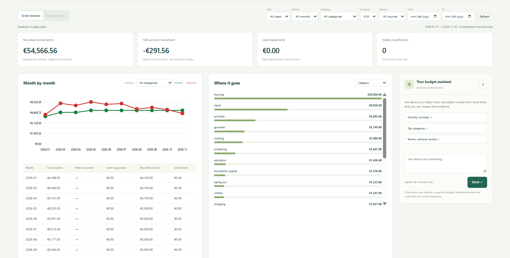
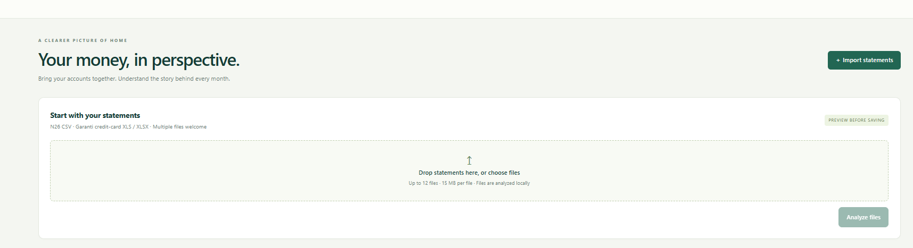
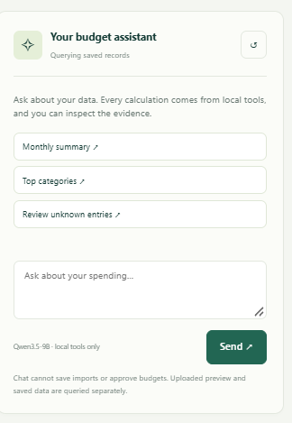

# Home Budget AI Assistant

A private financial workspace that turns everyday transaction records into a
clearer picture of your household finances. Bring supported statements together,
explore spending patterns, compare monthly income and expenses, and understand
where your money goes through interactive charts and category breakdowns.

An optional AI assistant lets you ask questions in natural language, with
calculations performed by local tools and supporting records available to
inspect. A read-only SQL workspace provides deeper exploration. English and
Turkish interfaces make it easy to navigate your records.

Built with Python, FastAPI, and SQLite, the app runs on your computer. Ollama
powers the local AI experience, keeping financial records and model processing
within your own environment.

## System and hardware

- **Core app:** Python 3.10+, a modern browser, and disk space for your local
  database. The dashboard and SQL workspace do not require a GPU or AI model.
- **Optional AI:** Ollama with the `qwen3.5:9b` model. Memory and disk needs depend
  on model quantization and context length; GPU acceleration improves response time.
- **Development setup:** Linux under WSL2, an AMD Ryzen 9 8945HS processor,
  approximately 16 GB of memory available to WSL, and an NVIDIA RTX 4070 Laptop
  GPU with 8 GB VRAM, as documented in the local model verification.
  This is the development configuration, not a minimum hardware requirement.

## Start the app

Requires Python 3.10 or newer. From the project folder:

```bash
python3 -m venv .venv
source .venv/bin/activate
pip install -r requirements-web.txt
python -m budget --db budget.sqlite web
```

Open **http://127.0.0.1:8000**.

## How to use

1. Upload supported CSV or Excel statements and click **Analyze files**.
2. Review transactions and categories, then confirm and save.
3. Filter the dashboard to explore monthly totals and spending categories.
4. Use the read-only SQL workspace or ask the assistant about your records.

For AI chat, run Ollama locally with the `qwen3.5:9b` model available.
Include the period and currency in your questions. The dashboard and SQL
workspace work without the model.

Files must match a supported statement layout. See [import details](docs/bank-imports.md).
Database files and transaction exports are excluded from Git.

## What's next

Planned directions for the project:

- **Forecasting:** project spending and cash flow, explore seasonal patterns,
  and compare what-if budget scenarios.
- **Investment analysis:** explore portfolio allocation, performance, and risk
  alongside household finances.
- **Broader financial analysis:** examine savings goals, recurring commitments,
  debt repayment scenarios, and longer-term financial trends.

These are roadmap goals; the current app focuses on imported records and
historical spending analysis.

## Screenshots






